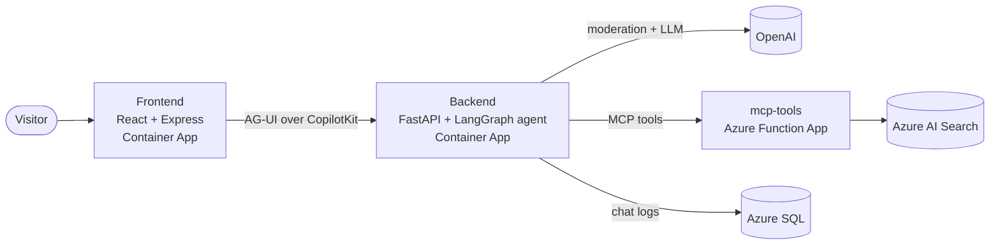

# Portfolio

My personal portfolio site: who I am, what I lead and what I built, plus Fredbot, an AI agent that answers questions about my projects and experience and shows each tool it calls.

**Live:** [frederikheda.com](https://frederikheda.com)

<!-- screenshot -->

## What it does

- Greets visitors with a terminal-style hero where they can chat with Fredbot instead of scrolling through a static page.
- Fredbot answers questions about my background, skills and projects, grounded in a knowledge base of my own documents (retrieval-augmented generation).
- The agent can drive the page: it can highlight projects and render project cards inline in the conversation.
- Replies render as Markdown, including typeset LaTeX math.
- Messages are moderated before they reach the model, and conversations are logged for review.
- Shows a condensed projects section and a privacy policy page, and works on mobile.

## How it works

The browser talks to a small Express server that serves the React app and proxies chat runs to the backend through the CopilotKit runtime. The backend exposes a LangGraph agent over the AG-UI protocol. Each message passes through a content-safety middleware (OpenAI's moderation API), then the model, and a logging middleware writes the exchange to Azure SQL afterwards.

The agent's backend tools (`get_profile`, `list_projects`, `get_project_details`, `retrieve_information`) are not defined in the backend. They are served by a separate Azure Function App over MCP, which is also where the vector search against Azure AI Search happens. The frontend registers two more tools that the agent can call to control the page. The whole stack is covered by an offline Playwright suite that runs the production build against the real backend, MCP handlers and agent graph, with only the model, moderation, SQL logging and Azure Search faked. It is a required check on `main`.

## Tech stack

- **Frontend:** React, Vite and Tailwind CSS for the UI; CopilotKit for the chat and frontend tools; Express to serve the build, proxy to the backend and set security headers.
- **Backend:** Python with FastAPI; LangGraph for the agent; OpenAI models for chat and moderation.
- **Tools and retrieval:** an Azure Function App exposing MCP tools; Azure AI Search for vector retrieval; a separate `data/` project that builds the search index.
- **Storage:** Azure SQL (passwordless, Microsoft Entra ID) for chat logs.
- **Hosting and delivery:** Azure Container Apps and Azure Functions, Bicep for infrastructure, GitHub Actions for CI and deploys.
- **Testing:** pytest, vitest, ESLint, ruff, pyright, and Playwright (end-to-end and accessibility checks).

## Repository layout

- `frontend/` - React app and the production Express server
- `backend/` - FastAPI app and the LangGraph agent
- `mcp-tools/` - Azure Function App with the MCP tools
- `data/` - scripts that build the Azure AI Search index
- `content/` - site content shared by the frontend and the MCP tools
- `e2e_backend/` - offline test servers for the Playwright suite
- `infra/`, `scripts/` - Bicep and deploy scripts

## More

- Run it locally and run the checks: [docs/development.md](docs/development.md)
- Deploy and operate it: [deployment/](deployment/)
