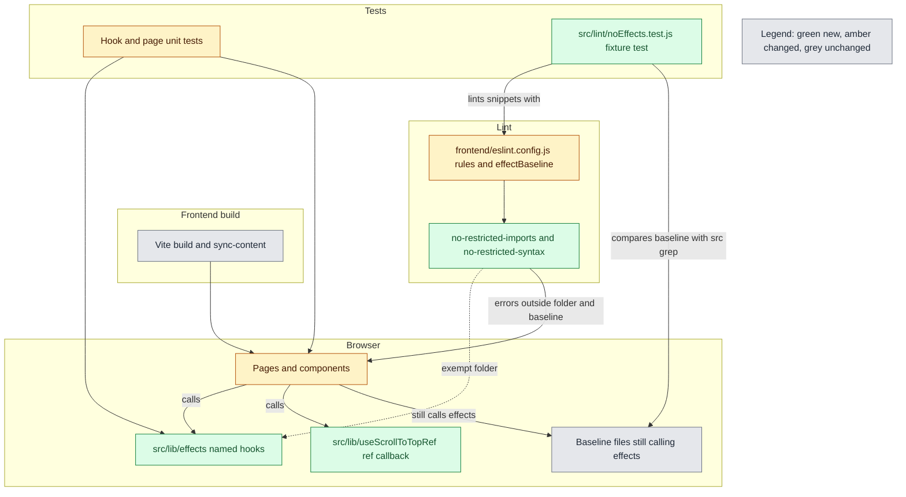

# No effects in components, part 1 (PW-80): plan

For agentic workers: run task by task. Steps are checkboxes; flip each `- [ ]` to `- [x]` when its step is done. Use `superpowers:subagent-driven-development` or `superpowers:executing-plans`.

**Goal:** ban React effect hooks in `frontend/src` outside `src/lib/effects/`, convert 9 of the 27 call sites, and list the 9 files that still need one in a baseline that part 2 (PW-81) empties.

**Architecture:** core ESLint rules in `frontend/eslint.config.js` (the rule, a folder exemption, a baseline override). Named hooks in `src/lib/effects/`. Non-effect means for scroll on mount (a ref callback), listener-free handlers for body scroll lock, and a `key` remount for ProjectPage.

**Tech Stack:** React 18.3.1, Vite 7, ESLint 9 flat config (`eslint`, `eslint-plugin-react`, `eslint-plugin-react-hooks`), vitest 5 with jsdom and `@testing-library/react` 16 (`renderHook`), react-router-dom 7.

**Spec:** `docs/specs/2026-11-22-no-use-effect.md`

**Global constraints:**
- No new dependency. No new comment in any file. Keep only the comments listed in Task 11.
- Edit files with Edit and Write only. `git mv` and `git commit` are the only shell file operations.
- Run every npm command from `frontend/`.
- The worktree has no `node_modules`. Before Task 1, run `npm ci` in `frontend/` (its `postinstall` builds the site).
- Two commits: the feature commit (Tasks 1 to 10), then the cleanup commit (Task 11). Messages are 2 lines max with no trailer.
- Changed files: 25 including docs. Do not add a file outside the list in Task 12.

## TL;DR

- Ships one PR: the lint ban on effect hooks, the effects folder, 9 call sites converted, and the baseline of 9 files.
- Nothing in production changes its behaviour; the existing tests cover every converted call except the About scroll, which gets a new test.
- Owner actions: none beyond the PR review. Two manual checks in Task 5 and Task 8 (menu lock, typing reveal).
- No cost: no paid API, no Azure resource.
- Part 2 (PW-81) takes the remaining 18 calls and empties the baseline.
- Risk: the TypedMarkdown reveal timer moves to `useInterval`; the first word must still show at mount (Task 8 keeps it).

## Architecture schematic

Source: `docs/plans/diagrams/2026-11-22-no-use-effect-part1.mmd`. Green new, amber changed, grey unchanged.



## Task 0: Baseline check

**Files:** none.

- [ ] **Step 1: Confirm the starting count**

Run from the repo root:

```bash
grep -rn -E "useEffect|useLayoutEffect|useInsertionEffect" frontend/src | wc -l
```

Expected output: `27`

- [ ] **Step 2: Confirm the starting file list**

```bash
grep -rl -E "useEffect|useLayoutEffect|useInsertionEffect" frontend/src | sort
```

Expected output (15 lines, paths relative to the repo root):

```
frontend/src/components/Diagram.jsx
frontend/src/components/Footer.jsx
frontend/src/components/FredbotPanel.jsx
frontend/src/components/Headers.jsx
frontend/src/components/PrivacyPolicy.jsx
frontend/src/components/terminal/ThinkingSequence.jsx
frontend/src/components/terminal/TypedMarkdown.jsx
frontend/src/lib/useBlogAvailable.js
frontend/src/lib/useDocumentHead.js
frontend/src/lib/useHashScroll.js
frontend/src/lib/useToolTimings.js
frontend/src/pages/About.jsx
frontend/src/pages/BlogIndex.jsx
frontend/src/pages/BlogPost.jsx
frontend/src/pages/ProjectPage.jsx
```

## Task 1: Lint rule, fixture test and baseline

**Files:**
- Create: `frontend/src/lint/noEffects.test.js`
- Modify: `frontend/eslint.config.js`

- [ ] **Step 1: Write the failing fixture test**

Create `frontend/src/lint/noEffects.test.js`:

```js
import { readdirSync, readFileSync, statSync } from 'node:fs';
import { join, relative, sep } from 'node:path';
import { fileURLToPath } from 'node:url';
import { ESLint } from 'eslint';
import { describe, expect, it } from 'vitest';
import { effectBaseline } from '../../eslint.config.js';

const FRONTEND = fileURLToPath(new URL('../..', import.meta.url));
const SRC = join(FRONTEND, 'src');
const EFFECTS_DIR = join(SRC, 'lib', 'effects');
const HOOK = /\buse(Layout|Insertion)?Effect\b/;
const TEST_FILE = /\.test\.jsx?$/;
const BANNED_RULES = new Set(['no-restricted-imports', 'no-restricted-syntax']);

const eslint = new ESLint({ cwd: FRONTEND });

const violations = {
  namedImport: 'import { useEffect } from "react";\nexport function C() { useEffect(() => {}); }\n',
  renamedImport: 'import { useEffect as e } from "react";\nexport function C() { e(() => {}); }\n',
  namespaceCall: 'import React from "react";\nexport function C() { React.useEffect(() => {}); }\n',
  layoutImport: 'import { useLayoutEffect } from "react";\nexport function C() { useLayoutEffect(() => {}); }\n',
};

async function bannedMessages(code, filePath) {
  const [result] = await eslint.lintText(code, { filePath });
  return result.messages.filter((message) => BANNED_RULES.has(message.ruleId));
}

function walk(dir) {
  return readdirSync(dir).flatMap((name) => {
    const path = join(dir, name);
    return statSync(path).isDirectory() ? walk(path) : [path];
  });
}

const sourceFiles = walk(SRC)
  .filter((path) => /\.jsx?$/.test(path) && !TEST_FILE.test(path))
  .filter((path) => !path.startsWith(EFFECTS_DIR + sep));

const relativePath = (path) => relative(FRONTEND, path).split(sep).join('/');

describe('effects rule', () => {
  it.each(Object.entries(violations))('flags %s outside src/lib/effects', async (_, code) => {
    const messages = await bannedMessages(code, join(SRC, 'components', 'Snippet.jsx'));
    expect(messages.length).toBeGreaterThan(0);
  });

  it.each(Object.entries(violations))('allows %s inside src/lib/effects', async (_, code) => {
    const messages = await bannedMessages(code, join(EFFECTS_DIR, 'snippet.js'));
    expect(messages).toEqual([]);
  });

  it('lists exactly the files that still call an effect hook', () => {
    const withHook = sourceFiles
      .filter((path) => HOOK.test(readFileSync(path, 'utf8')))
      .map(relativePath)
      .sort();
    expect(withHook).toEqual([...effectBaseline].sort());
  });

  it('has no eslint-disable for the effects rules in src', () => {
    const offenders = sourceFiles
      .filter((path) => /eslint-disable[^\n]*no-restricted-(imports|syntax)/.test(readFileSync(path, 'utf8')))
      .map(relativePath);
    expect(offenders).toEqual([]);
  });
});
```

- [ ] **Step 2: Run it and see it fail**

From `frontend/`:

```bash
npm test -- src/lint/noEffects.test.js
```

Expected output: the file fails to load with `SyntaxError: The requested module '../../eslint.config.js' does not provide an export named 'effectBaseline'`, and `Test Files  1 failed`.

- [ ] **Step 3: Add the rule, the folder exemption and the baseline to the config**

Edit `frontend/eslint.config.js`. First Edit: replace

old_string:
```js
import { defineConfig } from 'eslint/config';

export default defineConfig(
```

new_string:
```js
import { defineConfig } from 'eslint/config';

const EFFECTS = ["useEffect", "useLayoutEffect", "useInsertionEffect"];
const noEffects = {
  files: ["**/*.{js,jsx}"],
  rules: {
    "no-restricted-imports": ["error", {
      paths: [{ name: "react", importNames: EFFECTS,
        message: "No effects in components. Use a hook from src/lib/effects/ (see docs/development.md)." }],
    }],
    "no-restricted-syntax": ["error",
      { selector: "MemberExpression[property.name=/^use(Layout|Insertion)?Effect$/]", message: "No effects in components." },
      { selector: "MemberExpression[property.value=/^use(Layout|Insertion)?Effect$/]", message: "No effects in components." },
    ],
  },
};
const effectsFolder = { files: ["src/lib/effects/**"], rules: { "no-restricted-imports": "off", "no-restricted-syntax": "off" } };
const effectBaseline = [
  'src/components/Diagram.jsx',
  'src/components/FredbotPanel.jsx',
  'src/components/Footer.jsx',
  'src/components/Headers.jsx',
  'src/components/PrivacyPolicy.jsx',
  'src/components/terminal/ThinkingSequence.jsx',
  'src/components/terminal/TypedMarkdown.jsx',
  'src/lib/useBlogAvailable.js',
  'src/lib/useDocumentHead.js',
  'src/lib/useHashScroll.js',
  'src/lib/useToolTimings.js',
  'src/pages/About.jsx',
  'src/pages/BlogIndex.jsx',
  'src/pages/BlogPost.jsx',
  'src/pages/ProjectPage.jsx',
];
const effectBaselineOverride = {
  files: effectBaseline,
  rules: { 'no-restricted-imports': 'off', 'no-restricted-syntax': 'off' },
};

export { effectBaseline };

export default defineConfig(
```

Second Edit: replace

old_string:
```js
      'react-hooks/exhaustive-deps': 'error',
    },
  },
```

new_string:
```js
      'react-hooks/exhaustive-deps': 'error',
    },
  },
  noEffects,
  effectsFolder,
  effectBaselineOverride,
```

- [ ] **Step 4: Run the fixture test and see it pass**

```bash
npm test -- src/lint/noEffects.test.js
```

Expected output: `Tests  10 passed (10)`. The 4 `flags` cases, the 4 `allows` cases, the baseline case (15 names match the grep in Task 0) and the eslint-disable case.

- [ ] **Step 5: Lint the project**

```bash
npm run lint
```

Expected output: no errors (exit 0). The 15 baseline files are exempt, and no other file calls an effect.

- [ ] **Step 6: Owner-runnable gate**

Edit `frontend/src/components/Footer.jsx` temporarily is not allowed; instead confirm by a scratch file: create `frontend/src/components/Probe.jsx` with `import { useEffect } from 'react';\nexport default function Probe() { useEffect(() => {}); return null; }\n`, run `npx eslint src/components/Probe.jsx` from `frontend/`, expect an error `No effects in components`, then delete `Probe.jsx` with `rm frontend/src/components/Probe.jsx`. Expected: the eslint run prints `error  No effects in components` and exits 1. Delete the probe before continuing.

Commit is deferred to Task 10.

## Task 2: Effects folder hooks (useEventListener, useInterval, useTimeout)

**Files:**
- Create: `frontend/src/lib/effects/useEventListener.test.jsx`, `frontend/src/lib/effects/useEventListener.js`
- Create: `frontend/src/lib/effects/useInterval.test.jsx`, `frontend/src/lib/effects/useInterval.js`
- Create: `frontend/src/lib/effects/useTimeout.test.jsx`, `frontend/src/lib/effects/useTimeout.js`

- [ ] **Step 1: Write the failing test for useEventListener**

Create `frontend/src/lib/effects/useEventListener.test.jsx`:

```jsx
import { renderHook } from '@testing-library/react';
import { describe, expect, it, vi } from 'vitest';
import { useEventListener } from './useEventListener';

describe('useEventListener', () => {
  it('calls the latest handler for each event on the target', () => {
    const first = vi.fn();
    const second = vi.fn();
    const { rerender } = renderHook(({ handler }) => useEventListener(window, 'resize', handler), {
      initialProps: { handler: first },
    });
    window.dispatchEvent(new Event('resize'));
    rerender({ handler: second });
    window.dispatchEvent(new Event('resize'));
    expect(first).toHaveBeenCalledTimes(1);
    expect(second).toHaveBeenCalledTimes(1);
  });

  it('removes the listener on unmount', () => {
    const handler = vi.fn();
    const { unmount } = renderHook(() => useEventListener(window, 'resize', handler));
    unmount();
    window.dispatchEvent(new Event('resize'));
    expect(handler).not.toHaveBeenCalled();
  });

  it('passes the options to addEventListener', () => {
    const add = vi.spyOn(window, 'addEventListener');
    renderHook(() => useEventListener(window, 'scroll', vi.fn(), { passive: true }));
    expect(add).toHaveBeenCalledWith('scroll', expect.any(Function), { capture: undefined, passive: true });
    add.mockRestore();
  });
});
```

- [ ] **Step 2: Run it and see it fail**

```bash
npm test -- src/lib/effects/useEventListener.test.jsx
```

Expected output: `Error: Failed to resolve import "./useEventListener"` and `Test Files  1 failed`.

- [ ] **Step 3: Implement useEventListener**

Create `frontend/src/lib/effects/useEventListener.js`:

```js
import { useEffect, useRef } from 'react';

export function useEventListener(target, type, handler, options) {
  const handlerRef = useRef(handler);
  const capture = options?.capture;
  const passive = options?.passive;

  useEffect(() => {
    handlerRef.current = handler;
  });

  useEffect(() => {
    const listenerOptions = { capture, passive };
    const listener = (event) => handlerRef.current(event);
    target.addEventListener(type, listener, listenerOptions);
    return () => target.removeEventListener(type, listener, listenerOptions);
  }, [target, type, capture, passive]);
}
```

- [ ] **Step 4: Run it and see it pass**

```bash
npm test -- src/lib/effects/useEventListener.test.jsx
```

Expected output: `Tests  3 passed (3)`.

- [ ] **Step 5: Write the failing test for useInterval**

Create `frontend/src/lib/effects/useInterval.test.jsx`:

```jsx
import { renderHook } from '@testing-library/react';
import { afterEach, beforeEach, describe, expect, it, vi } from 'vitest';
import { useInterval } from './useInterval';

beforeEach(() => {
  vi.useFakeTimers();
});

afterEach(() => {
  vi.useRealTimers();
});

describe('useInterval', () => {
  it('calls the callback every delay, not at mount', () => {
    const callback = vi.fn();
    renderHook(() => useInterval(callback, 100));
    vi.advanceTimersByTime(99);
    expect(callback).not.toHaveBeenCalled();
    vi.advanceTimersByTime(1);
    expect(callback).toHaveBeenCalledTimes(1);
    vi.advanceTimersByTime(200);
    expect(callback).toHaveBeenCalledTimes(3);
  });

  it('pauses while the delay is null and stops on unmount', () => {
    const callback = vi.fn();
    const { rerender, unmount } = renderHook(({ delay }) => useInterval(callback, delay), {
      initialProps: { delay: null },
    });
    vi.advanceTimersByTime(1000);
    expect(callback).not.toHaveBeenCalled();
    rerender({ delay: 100 });
    vi.advanceTimersByTime(100);
    expect(callback).toHaveBeenCalledTimes(1);
    unmount();
    vi.advanceTimersByTime(1000);
    expect(callback).toHaveBeenCalledTimes(1);
  });

  it('calls the latest callback', () => {
    const first = vi.fn();
    const second = vi.fn();
    const { rerender } = renderHook(({ callback }) => useInterval(callback, 100), {
      initialProps: { callback: first },
    });
    rerender({ callback: second });
    vi.advanceTimersByTime(100);
    expect(first).not.toHaveBeenCalled();
    expect(second).toHaveBeenCalledTimes(1);
  });
});
```

- [ ] **Step 6: Run it and see it fail**

```bash
npm test -- src/lib/effects/useInterval.test.jsx
```

Expected output: `Failed to resolve import "./useInterval"` and `Test Files  1 failed`.

- [ ] **Step 7: Implement useInterval**

Create `frontend/src/lib/effects/useInterval.js`:

```js
import { useEffect, useRef } from 'react';

export function useInterval(callback, delay) {
  const callbackRef = useRef(callback);

  useEffect(() => {
    callbackRef.current = callback;
  });

  useEffect(() => {
    if (delay === null) return undefined;
    const id = setInterval(() => callbackRef.current(), delay);
    return () => clearInterval(id);
  }, [delay]);
}
```

- [ ] **Step 8: Run it and see it pass**

```bash
npm test -- src/lib/effects/useInterval.test.jsx
```

Expected output: `Tests  3 passed (3)`.

- [ ] **Step 9: Write the failing test for useTimeout**

Create `frontend/src/lib/effects/useTimeout.test.jsx`:

```jsx
import { renderHook } from '@testing-library/react';
import { afterEach, beforeEach, describe, expect, it, vi } from 'vitest';
import { useTimeout } from './useTimeout';

beforeEach(() => {
  vi.useFakeTimers();
});

afterEach(() => {
  vi.useRealTimers();
});

describe('useTimeout', () => {
  it('calls the callback once after the delay', () => {
    const callback = vi.fn();
    renderHook(() => useTimeout(callback, 900));
    vi.advanceTimersByTime(899);
    expect(callback).not.toHaveBeenCalled();
    vi.advanceTimersByTime(1);
    vi.advanceTimersByTime(5000);
    expect(callback).toHaveBeenCalledTimes(1);
  });

  it('never fires while the delay is null', () => {
    const callback = vi.fn();
    renderHook(() => useTimeout(callback, null));
    vi.advanceTimersByTime(10000);
    expect(callback).not.toHaveBeenCalled();
  });

  it('is cancelled on unmount', () => {
    const callback = vi.fn();
    const { unmount } = renderHook(() => useTimeout(callback, 100));
    unmount();
    vi.advanceTimersByTime(100);
    expect(callback).not.toHaveBeenCalled();
  });
});
```

- [ ] **Step 10: Run it and see it fail**

```bash
npm test -- src/lib/effects/useTimeout.test.jsx
```

Expected output: `Failed to resolve import "./useTimeout"` and `Test Files  1 failed`.

- [ ] **Step 11: Implement useTimeout**

Create `frontend/src/lib/effects/useTimeout.js`:

```js
import { useEffect, useRef } from 'react';

export function useTimeout(callback, delay) {
  const callbackRef = useRef(callback);

  useEffect(() => {
    callbackRef.current = callback;
  });

  useEffect(() => {
    if (delay === null) return undefined;
    const id = setTimeout(() => callbackRef.current(), delay);
    return () => clearTimeout(id);
  }, [delay]);
}
```

- [ ] **Step 12: Run the folder tests**

```bash
npm test -- src/lib/effects
```

Expected output: `Tests  9 passed (9)` and `Test Files  3 passed (3)`.

Commit is deferred to Task 10.

## Task 3: Move useDocumentHead into the effects folder

**Files:**
- Create: `frontend/src/lib/effects/useDocumentHead.test.jsx`
- Move: `frontend/src/lib/useDocumentHead.js` to `frontend/src/lib/effects/useDocumentHead.js` (content unchanged in this task)
- Modify: `frontend/src/pages/BlogPost.jsx`, `frontend/src/pages/BlogIndex.jsx`, `frontend/eslint.config.js`

- [ ] **Step 1: Write the failing test at the new location**

Create `frontend/src/lib/effects/useDocumentHead.test.jsx`:

```jsx
import { renderHook } from '@testing-library/react';
import { describe, expect, it } from 'vitest';
import { useDocumentHead } from './useDocumentHead';

describe('useDocumentHead', () => {
  it('sets the title and restores the previous one on unmount', () => {
    document.title = 'Before';
    const { unmount } = renderHook(() => useDocumentHead({ title: 'After' }));
    expect(document.title).toBe('After');
    unmount();
    expect(document.title).toBe('Before');
  });

  it('keeps the title when none is given', () => {
    document.title = 'Kept';
    renderHook(() => useDocumentHead({ title: undefined }));
    expect(document.title).toBe('Kept');
  });

  it('adds a noindex robots tag only while mounted', () => {
    const { unmount } = renderHook(() => useDocumentHead({ title: 'Page', noindex: true }));
    expect(document.head.querySelector('meta[name="robots"]')).toHaveAttribute('content', 'noindex');
    unmount();
    expect(document.head.querySelector('meta[name="robots"]')).toBeNull();
  });
});
```

- [ ] **Step 2: Run it and see it fail**

```bash
npm test -- src/lib/effects/useDocumentHead.test.jsx
```

Expected output: `Failed to resolve import "./useDocumentHead"` and `Test Files  1 failed`.

- [ ] **Step 3: Move the hook and update its importers**

Run from the repo root:

```bash
git mv frontend/src/lib/useDocumentHead.js frontend/src/lib/effects/useDocumentHead.js
```

The file content stays as it was:

```js
import { useEffect } from 'react';

// Sets the tab title (and, for a page that must stay out of search results,
// a noindex robots tag) while the page is shown, then puts both back.
export function useDocumentHead({ title, noindex = false }) {
  useEffect(() => {
    const previous = document.title;
    if (title) document.title = title;
    let meta;
    if (noindex) {
      meta = document.createElement('meta');
      meta.name = 'robots';
      meta.content = 'noindex';
      document.head.appendChild(meta);
    }
    return () => {
      document.title = previous;
      meta?.remove();
    };
  }, [title, noindex]);
}
```

Edit `frontend/src/pages/BlogPost.jsx`: replace

old_string: `import { useDocumentHead } from '../lib/useDocumentHead';`

new_string: `import { useDocumentHead } from '../lib/effects/useDocumentHead';`

Edit `frontend/src/pages/BlogIndex.jsx`: replace the same old_string with the same new_string.

Edit `frontend/eslint.config.js`: in the `effectBaseline` array, replace

old_string: `  'src/lib/useDocumentHead.js',\n`

new_string: empty (delete the line). Use Edit with old_string `  'src/lib/useDocumentHead.js',\n  'src/lib/useHashScroll.js',` and new_string `  'src/lib/useHashScroll.js',`.

- [ ] **Step 4: Run the tests**

```bash
npm test -- src/lib/effects src/pages/BlogPost.test.jsx src/pages/BlogIndex.test.jsx src/lint
```

Expected output: all listed files pass. `src/lint` reports `Tests  10 passed (10)`, with the baseline now 14 entries; the consistency test passes because `useDocumentHead.js` no longer exists under `src/lib`.

Commit is deferred to Task 10.

## Task 4: Footer uses useEventListener

**Files:**
- Modify: `frontend/src/components/Footer.jsx`
- Modify: `frontend/eslint.config.js`

The behaviour is already covered by `Footer.test.jsx` ("shows the back-to-top button only after scrolling, and scrolls to the top"). Run it before the change as a characterization check.

- [ ] **Step 1: Characterization run before the change**

```bash
npm test -- src/components/Footer.test.jsx
```

Expected output: `Tests  4 passed (4)`.

- [ ] **Step 2: Convert Footer**

Edit `frontend/src/components/Footer.jsx`. Replace

old_string:
```js
import { useEffect, useState } from 'react';
import { Link } from 'react-router-dom';
import { content } from '../lib/content';
import ContactLinks from './ContactLinks';
```

new_string:
```js
import { useState } from 'react';
import { Link } from 'react-router-dom';
import { content } from '../lib/content';
import { useEventListener } from '../lib/effects/useEventListener';
import ContactLinks from './ContactLinks';
```

Replace

old_string:
```js
  useEffect(() => {
    const onScroll = () => setShowTop(window.scrollY > 600);
    window.addEventListener('scroll', onScroll, { passive: true });
    return () => window.removeEventListener('scroll', onScroll);
  }, []);
```

new_string:
```js
  useEventListener(window, 'scroll', () => setShowTop(window.scrollY > 600), { passive: true });
```

- [ ] **Step 3: Remove Footer from the baseline**

Edit `frontend/eslint.config.js`: replace

old_string: `  'src/components/Footer.jsx',\n`

new_string: empty. Use old_string `  'src/components/Diagram.jsx',\n  'src/components/FredbotPanel.jsx',\n  'src/components/Footer.jsx',` and new_string `  'src/components/Diagram.jsx',\n  'src/components/FredbotPanel.jsx',`.

- [ ] **Step 4: Run the tests**

```bash
npm test -- src/components/Footer.test.jsx src/lint
```

Expected output: `Footer.test.jsx` 4 passed; `src/lint` 10 passed.

- [ ] **Step 5: Owner-runnable gate (manual)**

Start `npm run dev` in `frontend/` (serves on 127.0.0.1:5173). Open the home page, scroll down past 600 px: a round up-arrow button appears bottom right; click it: the page scrolls to the top. Stop `npm run dev` with Ctrl-C before continuing.

## Task 5: Headers sets the body scroll lock from its handlers

**Files:**
- Modify: `frontend/src/components/Headers.jsx`
- Modify: `frontend/eslint.config.js`

`Headers.test.jsx` "opens and closes the mobile menu" already asserts `document.body.style.overflow` is `hidden` open and `''` closed.

- [ ] **Step 1: Characterization run before the change**

```bash
npm test -- src/components/Headers.test.jsx src/components/Headers.blog.test.jsx
```

Expected output: `Test Files  2 passed (2)` and every test green. Record the `Tests` count from the summary line; Step 4 must report the same count.

- [ ] **Step 2: Convert Headers**

Edit `frontend/src/components/Headers.jsx`. Replace

old_string:
```js
import { useEffect, useState } from 'react';
```

new_string:
```js
import { useState } from 'react';
```

Replace

old_string:
```js
  const [mobileOpen, setMobileOpen] = useState(false);

  useEffect(() => {
    document.body.style.overflow = mobileOpen ? 'hidden' : '';
    return () => {
      document.body.style.overflow = '';
    };
  }, [mobileOpen]);

  const { pathname } = useLocation();
  const links = useBlogAvailable() ? [...navLinks, blogLink] : navLinks;
  const close = () => setMobileOpen(false);
```

new_string:
```js
  const [mobileOpen, setMobileOpen] = useState(false);

  const setMenu = (open) => {
    setMobileOpen(open);
    document.body.style.overflow = open ? 'hidden' : '';
  };

  const { pathname } = useLocation();
  const links = useBlogAvailable() ? [...navLinks, blogLink] : navLinks;
  const close = () => setMenu(false);
```

Replace

old_string: `            onClick={() => setMobileOpen((open) => !open)}`

new_string: `            onClick={() => setMenu(!mobileOpen)}`

- [ ] **Step 3: Remove Headers from the baseline**

Edit `frontend/eslint.config.js`: old_string `  'src/components/Headers.jsx',\n` removed. Use old_string `  'src/components/FredbotPanel.jsx',\n  'src/components/Headers.jsx',\n  'src/components/PrivacyPolicy.jsx',` and new_string `  'src/components/FredbotPanel.jsx',\n  'src/components/PrivacyPolicy.jsx',`.

Note: the baseline also still lists `Footer` only if Task 4 was skipped; it was removed in Task 4.

- [ ] **Step 4: Run the tests**

```bash
npm test -- src/components/Headers src/lint
```

Expected output: the same Headers counts as Step 1; `src/lint` 10 passed.

- [ ] **Step 5: Owner-runnable gate (manual)**

With `npm run dev` running, at a phone width (about 390 px, browser dev tools device mode), tap Menu: the page behind cannot scroll and the menu panel shows. Tap Menu again: the page scrolls normally. Tap a menu link: the menu closes and the page scrolls to the section. Stop `npm run dev`.

## Task 6: Scroll to top with a ref callback (About, PrivacyPolicy, ProjectPage)

**Files:**
- Create: `frontend/src/lib/useScrollToTopRef.js`, `frontend/src/pages/About.test.jsx`
- Modify: `frontend/src/components/PrivacyPolicy.jsx`, `frontend/src/pages/About.jsx`, `frontend/src/pages/ProjectPage.jsx`, `frontend/eslint.config.js`

Existing coverage: `PrivacyPolicy.test.jsx` "scrolls to the top on mount" and `ProjectPage.test.jsx` "keeps the toggle on and scrolls to the top when moving to another project". `About` has no test; its wiring is new, so it gets one.

- [ ] **Step 1: Write the About test first (characterization, passes on the current effect)**

Create `frontend/src/pages/About.test.jsx`:

```jsx
import { render } from '@testing-library/react';
import { describe, expect, it } from 'vitest';
import About from './About';

describe('About', () => {
  it('scrolls to the top on mount', () => {
    window.scrollTo.mockClear();
    render(<About />);
    expect(window.scrollTo).toHaveBeenCalledWith(0, 0);
  });
});
```

Run:

```bash
npm test -- src/pages/About.test.jsx
```

Expected output: `Tests  1 passed (1)`. This test guards the conversion below.

- [ ] **Step 2: Add the ref-callback hook**

Create `frontend/src/lib/useScrollToTopRef.js`:

```js
import { useCallback } from 'react';

export function useScrollToTopRef() {
  return useCallback((element) => {
    if (element) window.scrollTo(0, 0);
  }, []);
}
```

- [ ] **Step 3: Convert About**

Edit `frontend/src/pages/About.jsx`. Replace

old_string:
```js
import { useEffect } from 'react';
import ReactMarkdown from 'react-markdown';
import { content } from '../lib/content';
```

new_string:
```js
import ReactMarkdown from 'react-markdown';
import { content } from '../lib/content';
import { useScrollToTopRef } from '../lib/useScrollToTopRef';
```

Replace

old_string:
```js
export default function About() {
  useEffect(() => {
    window.scrollTo(0, 0);
  }, []);

  return (
    <article className="hero-wash">
```

new_string:
```js
export default function About() {
  const scrollToTop = useScrollToTopRef();

  return (
    <article ref={scrollToTop} className="hero-wash">
```

- [ ] **Step 4: Convert PrivacyPolicy**

Edit `frontend/src/components/PrivacyPolicy.jsx`. Replace

old_string:
```js
import { useEffect } from 'react';

function PrivacyPolicy() {
    useEffect(() => {
      window.scrollTo(0, 0);
    }, []);

  return (
    <div className="flex justify-center py-10 px-4">
```

new_string:
```js
import { useScrollToTopRef } from '../lib/useScrollToTopRef';

function PrivacyPolicy() {
  const scrollToTop = useScrollToTopRef();

  return (
    <div ref={scrollToTop} className="flex justify-center py-10 px-4">
```

- [ ] **Step 5: Convert ProjectPage**

Edit `frontend/src/pages/ProjectPage.jsx`. Replace

old_string:
```js
import { useEffect } from 'react';
import ReactMarkdown from 'react-markdown';
```

new_string:
```js
import ReactMarkdown from 'react-markdown';
```

Replace

old_string:
```js
import { useEngineerMode } from '../lib/useEngineerMode';
```

new_string:
```js
import { useEngineerMode } from '../lib/useEngineerMode';
import { useScrollToTopRef } from '../lib/useScrollToTopRef';
```

Replace

old_string:
```js
  const project = content.projects.find((p) => p.id === slug);

  useEffect(() => {
    window.scrollTo(0, 0);
  }, [slug]);

  if (!project) return <NotFound />;
```

new_string:
```js
  const project = content.projects.find((p) => p.id === slug);
  const scrollToTop = useScrollToTopRef();

  if (!project) return <NotFound />;
```

Replace

old_string: `    <article className="hero-wash">`

new_string: `    <article key={slug} ref={scrollToTop} className="hero-wash">`

- [ ] **Step 6: Remove the three files from the baseline**

Edit `frontend/eslint.config.js`: replace

old_string:
```js
  'src/components/PrivacyPolicy.jsx',
  'src/components/terminal/ThinkingSequence.jsx',
```

new_string:
```js
  'src/components/terminal/ThinkingSequence.jsx',
```

Replace

old_string:
```js
  'src/pages/About.jsx',
  'src/pages/BlogIndex.jsx',
  'src/pages/BlogPost.jsx',
  'src/pages/ProjectPage.jsx',
```

new_string:
```js
  'src/pages/BlogIndex.jsx',
  'src/pages/BlogPost.jsx',
```

- [ ] **Step 7: Run the tests**

```bash
npm test -- src/pages/About.test.jsx src/components/PrivacyPolicy.test.jsx src/pages/ProjectPage.test.jsx src/lint
```

Expected output: About 1 passed; PrivacyPolicy 2 passed; ProjectPage all passed; `src/lint` 10 passed.

- [ ] **Step 8: Owner-runnable gate (manual)**

With `npm run dev`: open `/projects/<any slug>` and scroll down, then click "All projects" in the header menu, then open another project from the list: the new project opens at its top. Open `/privacy-policy` scrolled down, follow the footer link to the policy again: the page opens at the top. Stop `npm run dev`.

## Task 7: FredbotPanel boot delay uses useTimeout

**Files:**
- Modify: `frontend/src/components/FredbotPanel.jsx`

`FredbotPanel.test.jsx` "shows the prompt only after the boot delay, without taking focus" covers the timer.

- [ ] **Step 1: Characterization run before the change**

```bash
npm test -- src/components/FredbotPanel.test.jsx
```

Expected output: all tests pass. Record the count.

- [ ] **Step 2: Convert the boot timer**

Edit `frontend/src/components/FredbotPanel.jsx`. Replace

old_string:
```js
import { content } from '../lib/content';
import { mathRehypePlugins, normalizeMathDelimiters } from '../lib/markdown';
```

new_string:
```js
import { content } from '../lib/content';
import { useTimeout } from '../lib/effects/useTimeout';
import { mathRehypePlugins, normalizeMathDelimiters } from '../lib/markdown';
```

Replace

old_string:
```js
  useEffect(() => {
    const t = setTimeout(() => setBooted(true), BOOT_DELAY_MS);
    return () => clearTimeout(t);
  }, []);
```

new_string:
```js
  useTimeout(() => setBooted(true), BOOT_DELAY_MS);
```

The `useEffect` import stays: eight other effects remain in this file.

- [ ] **Step 3: Run the test**

```bash
npm test -- src/components/FredbotPanel.test.jsx
```

Expected output: same count and all passing as Step 1.

## Task 8: TypedMarkdown reveal uses useInterval

**Files:**
- Modify: `frontend/src/components/terminal/TypedMarkdown.jsx`

The first word must appear at mount, as it does today: `revealed` starts at `min(tokens.length, WORDS_PER_TICK)`, which is the value the old immediate `tick()` produced. `TypedMarkdown.test.jsx` "reveals the text one word per tick" checks `tick(0)` shows `alpha`, so it guards this.

- [ ] **Step 1: Characterization run before the change**

```bash
npm test -- src/components/terminal/TypedMarkdown.test.jsx
```

Expected output: `Tests  4 passed (4)`.

- [ ] **Step 2: Convert the reveal**

Edit `frontend/src/components/terminal/TypedMarkdown.jsx`. Replace

old_string:
```js
import { mathRehypePlugins, normalizeMathDelimiters } from '../../lib/markdown';
```

new_string:
```js
import { useInterval } from '../../lib/effects/useInterval';
import { mathRehypePlugins, normalizeMathDelimiters } from '../../lib/markdown';
```

Replace

old_string:
```js
  const [revealed, setRevealed] = useState(0);
  const tokens = useMemo(() => tokenizeWords(text), [text]);
  const targetRef = useRef(tokens.length);
  const settledFiredRef = useRef(false);

  useEffect(() => { targetRef.current = tokens.length; }, [tokens.length]);

  useEffect(() => {
    let cancelled = false;
    let timer;

    function tick() {
      if (cancelled) return;
      setRevealed((current) => {
        if (current >= targetRef.current) return current;
        return Math.min(targetRef.current, current + WORDS_PER_TICK);
      });
      timer = setTimeout(tick, TICK_MS);
    }

    tick();
    return () => {
      cancelled = true;
      clearTimeout(timer);
    };
  }, []);
```

new_string:
```js
  const tokens = useMemo(() => tokenizeWords(text), [text]);
  const [revealed, setRevealed] = useState(() => Math.min(tokens.length, WORDS_PER_TICK));
  const settledFiredRef = useRef(false);

  useInterval(() => {
    setRevealed((current) => {
      if (current >= tokens.length) return current;
      return Math.min(tokens.length, current + WORDS_PER_TICK);
    });
  }, TICK_MS);
```

`useEffect` stays in the import: the scroll-follow and settle effects remain (rows 14 and 15 of the spec).

- [ ] **Step 3: Run the test**

```bash
npm test -- src/components/terminal/TypedMarkdown.test.jsx
```

Expected output: `Tests  4 passed (4)`. This proves the first word still appears at mount and one word per 135 ms follows.

- [ ] **Step 4: Owner-runnable gate (manual)**

With `npm run dev`, open `/#fredbot`, send a question (the chips work). The reply should type out word by word at the old pace, the first word appearing at once. Stop `npm run dev`.

## Task 9: Baseline check

**Files:** none changed in this task.

After Tasks 3 to 8 the baseline must hold exactly 9 entries: `Diagram.jsx`, `FredbotPanel.jsx`, `ThinkingSequence.jsx`, `TypedMarkdown.jsx`, `useBlogAvailable.js`, `useHashScroll.js`, `useToolTimings.js`, `BlogIndex.jsx`, `BlogPost.jsx`.

- [ ] **Step 1: Count the baseline**

Open `frontend/eslint.config.js` and count the entries in `effectBaseline`. Expected: 9 lines, exactly the paths above.

- [ ] **Step 2: Compare with the source**

From the repo root:

```bash
grep -rl -E "useEffect|useLayoutEffect|useInsertionEffect" frontend/src | grep -v -E "\.test\.jsx?$|src/lib/effects/" | sort
```

Expected output: the same 9 files (prefixed `frontend/`), no others.

- [ ] **Step 3: Run the full lint and unit suite**

```bash
npm run lint && npm test
```

Expected output: lint exits 0 with no output; `Test Files` all passed, no failures. Record the counts for the PR description.

## Task 10: Docs and the feature commit

**Files:**
- Modify: `docs/development.md`

- [ ] **Step 1: Add the Effects section**

Edit `docs/development.md`. Replace

old_string:
```markdown
## Checks
```

new_string:
```markdown
## Effects

Components do not call `useEffect`, `useLayoutEffect` or `useInsertionEffect`; ESLint fails on them (`frontend/eslint.config.js`). Effects that remain live in named hooks in `frontend/src/lib/effects/`, and a short list of files still calling an effect is in `effectBaseline` (the same file; part 2 empties it). Use this table instead of an effect:

| You wanted an effect to... | Do this instead |
|---|---|
| compute a value from props or state | compute it in render: `const shown = items.filter(matches)` |
| reset state when an id changes | put `key={id}` on the component; React remounts it with fresh state |
| respond to a click, submit or change | put the logic in the event handler |
| set state after a child reports something | pass the value up in the handler that caused it |
| set body or document style while a panel is open | set it in the open and close handlers |
| listen to `window` or `document` events | `useEventListener(window, 'scroll', handler, { passive: true })` |
| run something repeatedly | `useInterval(callback, ms)`; `null` pauses |
| run something once after a delay | `useTimeout(callback, ms)` |
| scroll to top when a page mounts or changes | `const scrollToTop = useScrollToTopRef();` on the page root; add `key={id}` to the root to remount on change |
| set the tab title while a page is shown | `useDocumentHead({ title, noindex })` |
| subscribe to an external store or agent | kept for part 2 (`useSubscription`) |
| fetch data when a page or panel shows | kept for part 2 (`useAsyncData`) |
| mount a third-party widget into a node | kept for part 2 (`useWidget`) |

## Checks
```

- [ ] **Step 2: Commit the feature change**

From the worktree root, stage the listed files only:

```bash
git add docs/specs/2026-11-22-no-use-effect.md docs/plans/2026-11-22-no-use-effect-part1.md docs/plans/diagrams/2026-11-22-no-use-effect-part1.mmd docs/development.md frontend/eslint.config.js frontend/src
git commit -m "PW-80: ban effect hooks outside src/lib/effects, baseline 15 to 9 files" -m "Convert 9 call sites with non-effect means and named hooks; spec and plan."
```

Expected output: one commit line `[pw80-no-use-effect-docs <sha>] PW-80: ban effect hooks ...` and `N files changed`. The message is 2 lines (subject plus one body line).

## Task 11: Cleanup commit (comments in touched files)

**Files:**
- Modify: `frontend/src/components/Headers.jsx`, `frontend/src/components/terminal/TypedMarkdown.jsx`, `frontend/src/components/FredbotPanel.jsx`, `frontend/src/lib/effects/useDocumentHead.js`

Rule for keeping a comment: it states a constraint of the platform or library, a security reason, or a workaround with its source. Everything else goes. Comments in `Footer`, `PrivacyPolicy`, `About`, `ProjectPage`, `BlogPost`, `BlogIndex` and the new files are checked in Step 6; none needs removing (the grep in Task 0 showed none in the first four; `BlogPost` and `BlogIndex` show no `//` lines in the touched code).

- [ ] **Step 1: Headers.jsx**

Delete this block (Edit old_string to empty; the line after it keeps its indentation):

old_string:
```js
// Section links point at the home page ("/#experience"), so they work from
// every route; useHashScroll on the home page does the scrolling.
```

Delete this block:

old_string:
```js
// The Blog link is the section's own page, not a home-page anchor: the page
// is current on /blog, the section on any /blog/<slug>.
```

Keep the `Solid background` block (constraint: a filter makes the header the containing block of the fixed mobile panel) and the `A link to the page you are already on does not scroll by itself.` line (browser constraint).

- [ ] **Step 2: TypedMarkdown.jsx**

Delete the top block:

old_string:
```js
// Reveals text a word at a time instead of snapping straight to whatever the
// backend just delivered -- makes even a fast or non-streaming response
// read as a steady terminal printout instead of popping in all at once.
// `text` may keep growing (real streaming) or arrive all at once; either
// way this only ever chases toward the current word count at its own pace.
```

Delete the NEAR_BOTTOM block:

old_string:
```js
// Only auto-follow the reply while the log is already scrolled near the
// bottom -- otherwise every tick of a long reply yanks a manually-scrolled
// user straight back down.
```

Keep the `Each token is a word plus whatever whitespace follows it...` block (it states why joining tokens reconstructs text).

Delete the follow-scroll block:

old_string:
```js
  // Keep the growing reply in view, but only while the log was already
  // scrolled near the bottom -- respects a manual scroll-up instead of
  // fighting it on every tick. Runs after each reveal actually commits, so
  // scrollHeight/scrollTop reflect the up-to-date DOM.
```

Delete the settle block:

old_string:
```js
  // Fires once, the moment this message has both stopped growing (isFinal)
  // and finished revealing everything it currently has -- signals the
  // parent it's safe to accept the next message.
```

- [ ] **Step 3: FredbotPanel.jsx**

Keep these blocks (constraint or workaround): `The panel sits mid-page...` (preventScroll), `Fire-and-forget warm-up ping...` (cold start workaround), `Once the reply has something to show...` (unmount constraint), `A run that fails...` (RUN_ERROR workaround), `Jump the log (not the window)...` (scroll constraint).

Delete each of these blocks in full (copy exact text from the file at this commit):
1. `// True from the first message's send until its real reply starts` through `// single instance never resets itself).` (8 lines above `const [introWaitActive...]`).
2. `// Escalating "still working" indicator for messages after the first one` through `// 3s -- covers slow real replies, e.g. an MCP tool call.` (5 lines above `const [waitStage...]`).
3. Trailing comment: replace `  const [waitStage, setWaitStage] = useState('none'); // 'none' | 'thinking' | 'sequence'` with `  const [waitStage, setWaitStage] = useState('none');`.
4. `// Input stays hidden for the whole exchange -- the fake sequence's own` through `// AND finish revealing at its throttled typing pace.` (3 lines).
5. `// The moment real content starts arriving for the in-flight reply, the` through `// rather than waiting for its own timers to unwind.` (3 lines).
6. `// Idle cursor-blink boot beat before the terminal "wakes up".` (1 line, above `useTimeout`).
7. `// The user's own message renders immediately via the turn list below --` through `// in the render) until the fake sequence ends.` (2 lines in sendMessage).
8. `// The intro theater plays once, on the first message of a session.` (1 line).
9. `// Escalating "still working" indicator, armed on every send: "thinking` through `// indicator picks up from the real elapsed time instead of resetting.` (5 lines in sendMessage).
10. `// A cleared thread is a new session -- the intro sequence should play` through `// again on its first message.` (2 lines in clearChat).
11. `// The reply stays hidden until the intro sequence finishes.` (1 line, JSX-level comment inside the map, keep its indentation as delete).

- [ ] **Step 4: useDocumentHead.js (moved file)**

Delete:

old_string:
```js
// Sets the tab title (and, for a page that must stay out of search results,
// a noindex robots tag) while the page is shown, then puts both back.
```

- [ ] **Step 5: useHashScroll.js (unchanged file, not touched by this PR)**

Not edited in this PR; leave its comments for part 2.

- [ ] **Step 6: Verify no touched file gained a comment and tests still pass**

```bash
git diff origin/main -- frontend/src | grep '^+' | grep -E '^\+\s*(//|/\*)'
```

Expected output: nothing printed.

```bash
cd frontend && npm run lint && npm test
```

Expected output: lint exit 0; all tests pass with the counts from Task 9 Step 3.

- [ ] **Step 7: Redundant tests**

No test is removed in this PR: each new test covers a hook or a page wiring that no other test checks (the fixture test, three hook files, the moved `useDocumentHead` test, and About). Confirm by reading the test names in the diff: `git diff origin/main --stat -- frontend/src` shows no deleted test lines.

- [ ] **Step 8: Commit the cleanup**

```bash
git add frontend/src/components/Headers.jsx frontend/src/components/terminal/TypedMarkdown.jsx frontend/src/components/FredbotPanel.jsx frontend/src/lib/effects/useDocumentHead.js
git commit -m "PW-80: remove comments in touched files" -m "Keep only constraint and workaround comments."
```

Expected output: one commit line and `4 files changed` (fewer lines than before).

## Task 12: Acceptance and PR

**Files:** none.

- [ ] **Step 1: Full checks**

From `frontend/`:

```bash
npm run lint && npm test && npm run e2e
```

Expected output: lint exit 0; vitest all green; Playwright all green. The e2e run needs `npx playwright install chromium` once and `poetry install` in `backend/` (see `docs/development.md`, "Browser tests"). Two runs at once need distinct ports.

- [ ] **Step 2: Count changed files and lines**

From the repo root:

```bash
git diff --stat origin/main | tail -1
```

Expected: 25 files changed or fewer (docs included) and a total changed-line count well under 5000.

- [ ] **Step 3: Before and after list for the PR description**

Run:

```bash
grep -rn -E "useEffect|useLayoutEffect|useInsertionEffect" frontend/src | wc -l
```

Expected output: `18` (27 minus the 9 converted call sites). Put in the PR description the table from `docs/specs/2026-11-22-no-use-effect.md` section 1 with the result column filled in, and the baseline change `15 to 9`.

- [ ] **Step 4: Open the PR**

Open a draft with `gh pr create --draft`, title `PW-80: ban effect hooks outside src/lib/effects (part 1)`. Before `gh pr ready`, run `auditing-branch-changes` and put its result in the PR-ready hand-over and the ticket comment. Run `./scripts/ci-local.sh` green before `gh pr ready`.

The PR description ends with the attribution line given by the session, and it lists the 9 converted call sites and the before/after table. It says `Comments: no file gains a comment; comment count drops in Headers.jsx, TypedMarkdown.jsx, FredbotPanel.jsx, useDocumentHead.js`.

## Self-check (done by the planner)

- Spec sections 1 to 6 are covered: the 27-call table (spec section 1), the rule (Task 1), the folder hooks (Tasks 2, 3), the cheat sheet (Task 10), the baseline (Tasks 1, 3, 4, 5, 6, 9), acceptance (Task 12).
- Names checked across tasks: `useEventListener`, `useInterval`, `useTimeout`, `useDocumentHead` (moved), `useScrollToTopRef`, `effectBaseline`, `effectBaselineOverride`, `noEffects`, `effectsFolder`.
- The baseline is 15 after Task 1, 14 after Task 3, 13 after Task 4, 12 after Task 5, 9 after Task 6. Task 9 verifies 9.
